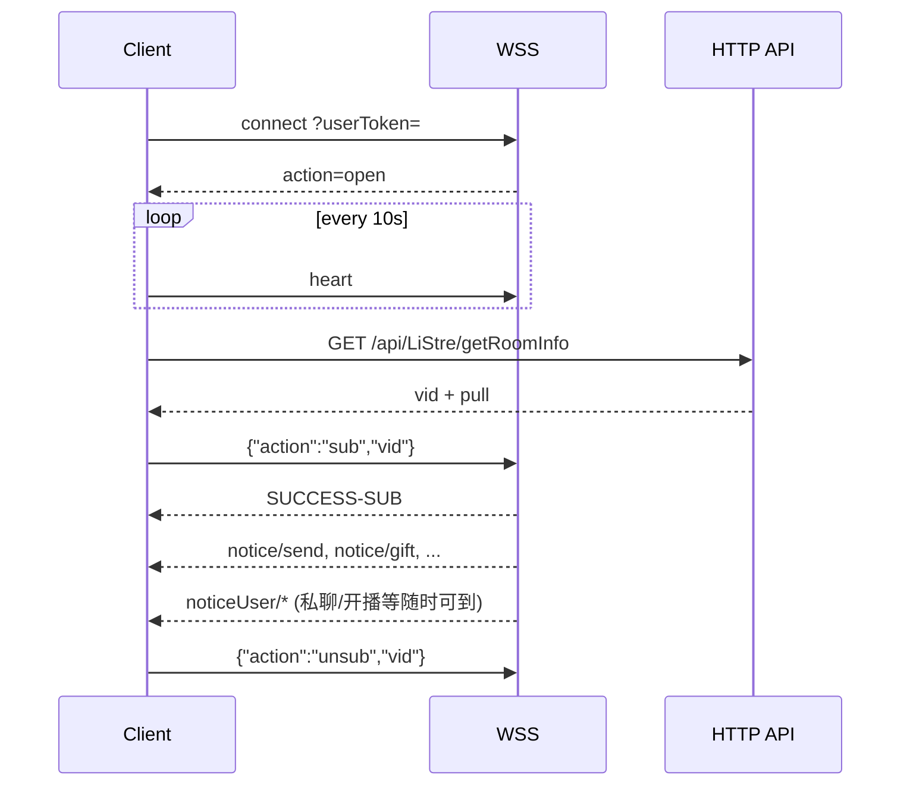

# Klive Pre WebSocket（WS）完整说明
> 前台API地址：https://streampre.fdsser.com/  
> 官方DOC：https://streampreadmin.fdsser.com/doc/  
> LIVE_API WS：https://streampreadmin.fdsser.com/doc/liveDoc →「WS相关」  
> 前台连线域：`wss://streampre.fdsser.com/wss/?userToken=...`  
> 日期：2026-10-05

## 1. 总览

连上 WS 后即可收到**私聊 / 通知**类消息；**直播间公屏（广场）消息必须先 `sub` 订阅房间**才会推送。

### 1.1 method 通道一览

| method | 是否需 sub | 用途 |
| --- | --- | --- |
| `notice` | **是**（房间订阅） | 直播间公屏、送礼、禁言、房间内删消息/清屏等 |
| `noticeUser` | 否（连上即收） | 私聊/群组消息、新消息提醒、进群/被踢、关注开播、置顶、预约开播等 |
| `noticeAll` | 视场景 | 当前所在直播间关播等全站/房间广播 |
| `noticeIm` | 否 | IM 相关推送 |
| `noticeChannel` | 视场景 | 渠道级推送 |
| `noticeChannelsByDay` | 视场景 | 直播间聊天公告（图文模版等） |

### 1.2 action 一览（接收侧）

| action | 典型 method | 说明 | 需 sub |
| --- | --- | --- | --- |
| `send` | `notice` | 直播间公屏消息 | 是 |
| `send` | `noticeUser` | 私聊/群组消息 | 否 |
| `send` | `noticeChannelsByDay` | 聊天公告 | 视公告配置 |
| `gift` | `notice` | 直播间送礼 | 是 |
| `ban` | `notice` | 禁言 | 是（房间） |
| `delmsg` | `notice` / `noticeUser` | 删除单条消息 | 通道不同 |
| `clearHistory` | `notice` / `noticeUser` | 一键清屏/清空历史 | 通道不同 |
| `newMsg` | `noticeUser` | 群聊/私聊有新消息提醒 | 否 |
| `newRoom` | `noticeUser` | 加入群组提醒 | 否 |
| `kickuser` | `noticeUser` | 被踢出群组 | 否 |
| `startLive` | `noticeUser` | 关注的主播开播 | 否 |
| `closeLive` | `noticeAll` | 当前所在直播间关播 | — |
| `pin` / `unpin` | `noticeUser` | 消息置顶 / 取消置顶 | 否 |
| `reserveStartLive` | `noticeUser` | 预约节目到点开始 | 否 |

房间类型 `room_type`：`0` 直播间 / `1` 群组 / `2` 私聊。  
`qos`：`1` 私聊 / `0` 非私聊。  
`sender_user_type`：`0` 游客 / `1` 后台管理员 / `2` 会员。  
`pm_source_type`：`0` 未知 / `1` 直播间私聊 / `2` 直播间聊天列表 / `3` 聊天列表 / `4` 节目播放间聊天列表。

---

## 2. 客户端上行（必须）

### 2.1 连线

```
GET wss://streampre.fdsser.com/wss/?userToken={Token}
```

- https 页面用 `wss`，http 用 `ws`
- Token：登录用 `vn__token`；游客用 visitor token
- 连线成功后服务端会回 `action: open`（含 `userId` / `userType` / `vid` / `token` 等）

`userType`：`0` 游客 / `1` 用户。

### 2.2 心跳

明文发送（建议每 **10 秒**）：

```
heart
```

### 2.3 进入直播间（订阅）

```json
{ "action": "sub", "vid": "<房间vid>" }
```

- **进房必发**；`vid` 来自 `GET /api/LiStre/getRoomInfo`
- 成功响应示例：`{"action":"response","code":0,"msg":"SUCCESS-SUB-..."}`

### 2.4 退出直播间（取消订阅）

```json
{ "action": "unsub", "vid": "<房间vid>" }
```

- **退房必发**
- 成功：`msg` 形如 `SUCCESS-UNSUB-...`

---

## 3. 服务端下行（接收）详解

### 3.1 直播间公屏 `notice` + `send`

**条件**：已 `sub` 该 `vid`。

```json
{
  "method": "notice",
  "action": "send",
  "vid": "房间vid",
  "msg_id": 1757582091219659,
  "msg_type": 1,
  "text": "消息文本",
  "originalText": "原始文本",
  "avatar": "头像URL",
  "sender": 1,
  "sender_nickname": "昵称",
  "sender_user_type": 2,
  "sender_exp": 10,
  "qos": 0,
  "room_type": 0,
  "pm_source_type": 0,
  "time": "2025-09-11 17:14:51",
  "seed": "hash",
  "prefix": "vn"
}
```

发言角色常见：`user` / `bot` / `admin` / `sticker` / `visitor` 等（以实际字段与 `sender_user_type` 为准）。

`msg_type`（公告/消息类型常见）：`0` 弹幕 / `1` 文字 / `2` 图片 / `3` 模版（公告场景）。

### 3.2 私聊 / 群组消息 `noticeUser` + `send`

**条件**：WS 已连接即可，**无需 sub**。

```json
{
  "method": "noticeUser",
  "action": "send",
  "vid": "会话vid",
  "qos": 1,
  "room_type": 2,
  "text": "...",
  "sender_nickname": "...",
  "sender_user_type": 0,
  "pm_source_type": 1,
  "anchor_from": "20"
}
```

常见子场景：私聊·游客发言 / 私聊·后台管理员 / 群组消息等，统一走 `noticeUser`。

### 3.3 删除消息 `delmsg`

| 场景 | method |
| --- | --- |
| 按用户推送（私聊/群） | `noticeUser` |
| 按房间订阅推送（直播间） | `notice` |

分发：`noticeUser`=按用户；`notice`=按房间订阅。`room_type`：0 直播间 / 1 群组 / 2 私聊。

### 3.4 清空历史 / 清屏 `clearHistory`

通道规则同 `delmsg`（`noticeUser` vs `notice`）。

### 3.5 新消息提醒 `noticeUser` + `newMsg`

群聊/私聊有新消息时提醒（角标/会话列表刷新用）。

### 3.6 加入群组 `noticeUser` + `newRoom`

加入聊天室时提醒。

### 3.7 踢出群组 `noticeUser` + `kickuser`

被踢出时提醒。

### 3.8 关注主播开播 `noticeUser` + `startLive`

```json
{
  "method": "noticeUser",
  "action": "startLive",
  "uid": 247,
  "title": "直播标题",
  "thumb": "封面"
}
```

### 3.9 当前直播间关播 `noticeAll` + `closeLive`

```json
{
  "method": "noticeAll",
  "action": "closeLive",
  "vid": "房间vid"
}
```

与 `startLive` 差异：`noticeUser` 按用户推送开播；`noticeAll` 广播关播。

### 3.10 送礼 `notice` + `gift`

**需已订阅直播间。**

```json
{
  "method": "notice",
  "action": "gift",
  "vid": "AAAAAAAA12356778BBBBBBBBCCCCCCCC",
  "gift_id": "73",
  "sender_nickname": "...",
  "sender_exp": "10",
  "sender_user_type": 2,
  "seed": "febbba09990f3ab55c13521ad5f1b1b2",
  "prefix": "vn"
}
```

### 3.11 聊天公告 `noticeChannelsByDay` + `send`

含 `msg_type`（0 弹幕 / 1 文字 / 2 图片 / 3 模版）、`title`、`text`、`pic`、`link`、`type`（0 直播 / 1 群组 / 2 私信）等。

### 3.12 禁言 `notice` + `ban`

后台对直播间/群组用户或游客禁言。

```json
{
  "method": "notice",
  "action": "ban",
  "vid": "...",
  "uid": 123
}
```

### 3.13 消息置顶 `noticeUser` + `pin`

```json
{
  "method": "noticeUser",
  "action": "pin",
  "pin": 1,
  "data": "{...置顶消息JSON...}",
  "vid": "..."
}
```

- `pin=1` 置顶；`pin=2` 取消置顶（也可见 `unpin` action）
- `data` 内嵌完整消息体

### 3.14 预约节目开始 `noticeUser` + `reserveStartLive`

用户在节目列表预约后，到预定开播时间推送（**不论是否有主播在播该节目**）。

### 3.15 其他推送（LIVE_API 目录提及）

| 场景 | 说明 |
| --- | --- |
| 满级/充值大户进房特效 | 额外进房特效推送 |
| 通知开新房 | `noticeUser` 类开房通知 |
| 系统提示 / 回馈消息 | 系统提示 |
| 游客转用户队列 | 游客注册转正相关 |
| 运营切播事件 | `noticeAll` 运营事件 WS |
| 定时投票数据 | 投票数据定时推送 |
| Chat 置顶 | 群组置顶相关 |

---

## 4. 推荐客户端处理流程



### 4.1 接收分发伪代码

```js
ws.onmessage = (ev) => {
  if (ev.data === 'pong' || !ev.data) return;
  let msg;
  try { msg = JSON.parse(ev.data); } catch { return; }
  const { method, action } = msg;
  if (method === 'notice' && action === 'send') renderRoomChat(msg);
  else if (method === 'notice' && action === 'gift') playGift(msg);
  else if (method === 'notice' && action === 'ban') applyBan(msg);
  else if (method === 'noticeUser' && action === 'send') renderPrivateOrGroup(msg);
  else if (method === 'noticeUser' && action === 'newMsg') bumpUnread(msg);
  else if (method === 'noticeUser' && action === 'startLive') notifyAnchorLive(msg);
  else if (method === 'noticeAll' && action === 'closeLive') handleRoomClosed(msg);
  else if (method === 'noticeUser' && action === 'pin') updatePinned(msg);
  else if (method === 'noticeUser' && action === 'reserveStartLive') notifyReserved(msg);
  // ... delmsg / clearHistory / newRoom / kickuser
};
```

---

## 5. 官方原文摘录（LIVE_API WS相关）

以下为从官方 liveDoc 抽取的 WS 章节原文要点（保留关键句）：

```text
WS相关


-----

DESCRIPTION

ws 长链接请求成功后即可收到相关聊天信息或通知，但直播间的广场聊天消息不同，需要订阅才能收到消息。
订阅动作请参考 ws进入直播间
ws 方法说明列表

    
    

        method
        说明
    
    
    
    

        notice
        根据 vid 栏位发送讯息
(订阅房间才收到消息[订阅动作请参考
            ws进入直播间])
        
    
    

        noticeUser
        根据 crossUserId 栏位发送讯息
(单一或多个用户id)
    
    

        noticeIm
        im 处理事件
(根据 crossUserId 栏位发送讯息)
    
    

        noticeChannel
        渠道消息发送
    
    

        noticeChannelsByDay
        渠道消息发送
    
    

        noticeAll
        跨平台广播各im
(用于全平台广播)
    
    

ws 相关类别说明列表

    
    

        method
        action
        说明
        前后台
    
    
    
    
    

        notice
        send
        一般信息
        前后台
    
    

        gift
        送礼消息
        前后台
    
    

        system
        用户/访客进房消息
        后台
    
    

        inRoom
        满级（以及充值大户）用户进入房间有额外特效的推送
        前后台
    
    

        redbag
        红包消息
        前台
    
    

        redbagOn
        红包消息, 有用户领取红包
        
    
    

        msg_hint
        助手智能自动回复
        
    
    

        ban
        封禁一个用户
        前台
    
    

        delmsg
        删除条消息
        前后台
    
    

        clearHistory
        删除历史消息
        前后台
    
    

        updateGroupName
        修改群组名称
        后台
    
    

        updateGroupPic
        上传群组封面图
        后台
    

    
    

        noticeUser
        useronline
        在线变更通知
        后台
    
    

        newRoom
        通知开新房/推送通知
        前台
    
    

        newMsg
        新消息
        前台
    
    

        send
        一般消息
        前台
    
    

        usertag
        删除标签通知
        
    
    

        readed
        标记房间已读
        后台
    
    

        pin
        Chat 置顶
        后台
    
    

        delmsg
        删除条消息
        前后台
    
    

        clearHistory
        删除历史消息
        前后台
    
    

        kickuser
        
        通知踢出群组
        后台
    
    

        msg
        系统提示消息 | 推送回馈消息
        后台
    
    

        startLive
        
        添加开播通知(关注主播的人需要被通知)
        前台
    
    

        reserveStartLive
        预约节目开始通知
        前台
    
    

        visitorToUser
        推送当前游客队列(当前台游客注册后转用户的类别)
        后台
    

    
    

        noticeIm
        inLeaveRoom
        通知所有im自己在线的token换房间
        后台
    

    
    

        noticeChannel
        send
        渠道消息发送
        前台
    

    
    

        noticeChannelsByDay
        
            send
        
        聊天公告通知
        前台
    

    
    

        noticeAll
        toggle
        运营事件推送WS订阅(切播事件推送)
        后台
    
    

        useronline
        变更在线/离线
        后台
    
    

        vote
        定时推送投票数据
        
    
    

        closeLive
        
        直播关闭通知
        前台
    
    


-----

ws连线


-----

PATH

GET wss://{数据服务域名}/wss/?userToken={Token}


-----

DESCRIPTION

ws 长链接请求，toeken 请求成功后服务响应示例

                            
{
  "action": "open",
  "fd": 3,
  "prefix_l": "bct:",   //原分平台单利标示[现已废弃无用]
  "prefix_g": "bct::",  //原分平台集群标示[现已废弃无用]
  "info": { //token解密后获得用户信息
    "prefix": "bct",                           //平台号
    "channelCode": "bct",                      //渠道号
    "channelId": 2,                            //渠道ID
    "userId": 1726212481000001,                //用户ID
    "username": "1726212481000001",            //用户暱称
    "userType": 0,                             //用户类别(0:游客,1:用户)
    "token": "xxxxxxxxxxxxxxxxxxx",            //vn-Token
    "day": 1,                                  //登录第几天
    "fingerprcint": "iwuroweuriow666",         //vn-Oaid
    "vid": "AAABBBCCC",                        //直播间房间vid
    "onlineAt": 1757400710                     //当前响应时间戳(10位数)
  },
  "hostname": "4b65b9eca1a9:2070:32141",       //了解哪台服务送资料的辨识码
  "version": "24-07/28#15-8.3.8"               //版本号
}
                            
                        


-----

ws心跳


-----

DESCRIPTION

心跳 (建议每10秒主动请求一次)

                            
"heart"
                            
                        


-----

ws进入直播间


-----

DESCRIPTION

"action": "sub" 当进入直播间时，请务必通知进房

                            
{
  "action": "sub",      //表示订阅该直播间
  "vid": "AAABBBCCC"    //房间vid (在 /api/LiStre/getRoomInfo 直播间房间讯息可见)
}

// 请求成功时，服务器响应
{
  "action": "response",
  "code": 0,            //code=0，表示成功
  "msg": "SUCCESS-SUB-AAABBBCCC"
}
                            
                        


-----

ws退出直播间


-----

DESCRIPTION

"action": "unsub" 当退出直播间时，请务必通知退房

                            
{
  "action": "unsub",    //表示取消订阅该直播间
  "vid": "AAABBBCCC"    //房间vid (在 /api/LiStre/getRoomInfo 直播间房间讯息可见)
}

// 请求成功时，服务器响应
{
  "action": "response",
  "code": 0,            //code=0，表示成功
  "msg": "SUCCESS-UNSUB-AAABBBCCC"
}
                            
                        


-----

ws各情境消息状态


-----

DESCRIPTION

以下示例各个 ws 情境


-----

ws直播间消息

DESCRIPTION

    {"method":"notice","action":"send"} 当已订阅直播间，接收到消息时[用于直播间，只有订阅时才会收到]

    
    
    直播间·用户发言 user

    
    直播间·机器人发言 bot

    
    直播间·后台管理员发言 admin

    
    直播间·用户发贴图 sticker

    
    
        
        
      
{
    "action": "send",                           //动作识别:一般讯息
    "msg_id": 1757560499017724,                 //讯息id(通常16位数字)
    "vid": "AAAAAAAA12356778BBBBBBBBCCCCCCCC",  //直播间 vid(通常32位数字+字母)
    "text": "123",                              //讯息内容
    "type": 0,                                  //房间类型：[0:直播, 1:群组, 2:私信]
    "msg_type": 1,                              //讯息类型：[0:弹幕 1:文字, 2:图片, 3:模版(图+文)]
    "sender": 633,                              //消息发送者ID
    "sender_user_type": 2,                      //消息发送者的类型(1:后台管理者,2:会员,0:游客)
    "sender_nickname": "用户7877",               //消息发送者的暱称
    "time": "2025-09-11 11:14:59",              //消息时间
    "time_ms": 1757560499040,                   //消息时间戳
    "avatar": "http://test.com//upload/default/20240827/e69912167837a46c64e1628808ae5f43.450x450.png",  //頭像
    "channel_id": 0,                            //后台专门发渠道信息用的
    "seed": "19dd84ba60860fc0d02a0188a9ce5d57", //唯一识别
    "originalText": "123",                      //原始内容
    "has_tag": 0,                               //是否有标签(1:是,0:否)
    "designation": "",                          //头衔
    "designation_color": 0,                     //头衔颜色
    "sender_total_exp": 0,                      //总经验
    "sender_exp": 1,                            //用户经验等级
    "block_channel": [],                        //需要屏蔽的渠道ID
    "readed_count": 0,                          //已读未读标记(2:已读,0:未读)
    "qos": 0,                                   //是否私聊(1:是,0:否)
    "is_batch": 0,                              //是否后台批量发送的消息(1:是,0:否)
    "anchor_id": "",                            //主播ID
    "anchor_nickname": "",                      //主播暱称
    "pm_source_type": 0,                        //发言来源类型 [0-未知 1-直播间私聊 2-直播间聊天列表 3-聊天列表 4-节目播放间聊天列表]
    "topOneUid": "",                            //topOne的Uid
    "pic": "",                                  //贴图地址
    "pic_bnc": "",                              //图片加密为 .bnc
    "prefix": "vn",                            //平台识别
    "method": "notice"                          //chat swoole 要用到的 method
}
      
        

        
      
{
    "action": "send",                           //动作识别:一般讯息
    "comment": "comment",                       //火星论坛或机器人才会有这个字段
    "vid": "AAAAAAAA12356778BBBBBBBBCCCCCCCC",  //直播间 vid(通常32位数字+字母)
    "type": 0,                                  //房间类型：[0:直播, 1:群组, 2:私信]
    "room_type": 0,                             //房间类型：[0:直播, 1:群组, 2:私信](火星论坛或机器人才会有这个字段)
    "msg_id": 1757561004108216,                 //讯息id(通常16位数字)
    "text": "真的准",                            //讯息内容
    "pic": "",                                  //贴图地址
    "msg_type": 1,                              //讯息类型：[0:弹幕 1:文字, 2:图片, 3:模版(图+文)]
    "time": "2025-09-11 11:23:24",              //消息时间
    "time_ms": 1757561004108,                   //消息时间戳
    "sender": 9,                                //消息发送者ID
    "sender_user_type": 2,                      //消息发送者的类型(1:后台管理者,2:会员,0:游客)
    "sender_nickname": "我是等级4",               //消息发送者的暱称
    "avatar": "https://test.com/upload/web_studio/20230810/ca8fbe14ff135d4faeda980d5e1d807c.jpeg",        //消息发送者的頭像
    "sender_avatar": "https://test.com/upload/web_studio/20230810/ca8fbe14ff135d4faeda980d5e1d807c.jpeg", //消息发送者的頭像
    "sender_total_exp": 800,                     //总经验
    "sender_exp": 2,                             //用户经验等级
    "designation": "",                           //消息发送者的头衔
    "designation_color": 0,                      //消息发送者的头衔颜色
    "sender_designation": "",                    //消息发送者的头衔(火星论坛或机器人才会有这个字段)
    "sender_designation_color": 0,               //消息发送者的头衔颜色(火星论坛或机器人才会有这个字段)
    "seed": "f9defff6b7eaeed9e8a88664d6c57eb8",  //唯一识别
    "prefix": "vn",                             //平台识别
    "meth

-----

ws私聊/群组消息

DESCRIPTION

    {"method":"noticeUser","action":"send"} 接收到私聊/群组消息时[不需要订阅，只要连上ws即可接收]

    
    私聊·游客发言 visitor

    
    私聊·后台管理员发言 admin

    
    群组·用户发言 user

    
    群组·后台管理员发言 admin

    
    
        
      
{
    "action": "send",                           //动作识别:一般讯息
    "msg_id": 1757915596471810,                 //讯息id(通常16位数字)
    "time_ms": 1757915596476,                   //消息时间戳
    "vid": "AAAAAAAA12356778BBBBBBBBCCCCCCCC",  //直播间 vid(通常32位数字+字母)
    "text": "iopop",                            //讯息内容
    "type": 2,                                  //房间类型：[0:直播, 1:群组, 2:私信]
    "msg_type": 1,                              //讯息类型：[0:弹幕 1:文字, 2:图片, 3:模版(图+文)]
    "sender": 1757901049000001,                 //消息发送者ID
    "anchor_id": 1757901049000001,              //主播ID
    "anchor_from": "20",                        //推送消息的来自问题
    "channel_id": 0,                            //后台专门发渠道信息用的
    "seed": "a5c8515efc74afe23493ba9d47f53fc1", //唯一识别
    "originalText": "iopop",                    //原始内容
    "has_tag": 0,                               //是否有标签(1:是,0:否)
    "designation": "",                          //头衔
    "designation_color": 0,                     //头衔颜色
    "block_channel": [],                        //需要屏蔽的渠道ID
    "readed_count": 0,                          //已读未读标记(2:已读,0:未读)
    "qos": 1,                                   //是否私聊(1:是,0:否)
    "is_batch": 0,                              //是否后台批量发送的消息(1:是,0:否)
    "pm_source_type": 0,                        //发言来源类型 [0-未知 1-直播间私聊 2-直播间聊天列表 3-聊天列表 4-节目播放间聊天列表]
    "pm_source_type_str": "494",                //助理id
    "topOneUid": "",                            //topOne的Uid
    "pic": "",                                  //贴图地址
    "time": "2025-09-15 13:53:16",              //消息时间
    "avatar": "",                               //頭像
    "sender_exp": 1,                            //用户经验等级
    "sender_user_type": 0,                      //消息发送者的类型(1:后台管理者,2:会员,0:游客)
    "sender_nickname": "游客1757901049000001",   //消息发送者的暱称
    "pic_bnc": "",                              //图片加密为 .bnc
    "prefix": "vn",                            //平台识别
    "method": "noticeUser"                      //chat swoole 要用到的 method
}
      
        

        
      
{
    "action": "send",                            //动作识别:一般讯息
    "msg_id": 1757915834673058,                  //讯息id(通常16位数字)
    "vid": "AAAAAAAA12356778BBBBBBBBCCCCCCCC",   //直播间 vid(通常32位数字+字母)
    "text": "88888",                             //讯息内容
    "type": 2,                                   //房间类型：[0:直播, 1:群组, 2:私信]
    "msg_type": 1,                               //讯息类型：[0:弹幕 1:文字, 2:图片, 3:模版(图+文)]
    "sender": 494,                               //消息发送者ID
    "sender_user_type": 1,                       //消息发送者的类型(1:后台管理者,2:会员,0:游客)
    "sender_nickname": "momo1",                  //消息发送者的暱称
    "time": "2025-09-15 13:57:14",               //消息时间
    "time_ms": 1757915834710,                    //消息时间戳
    "avatar": "https://test.com/upload/admin/20250702/a585baa04d0f11c1c5a3e7c57ece8839.1080x1080.jpeg",  //頭像
    "channel_id": 0,                             //后台专门发渠道信息用的
    "seed": "bb1e247f5a8a20dcb5d4d85b0cac9d0c",  //唯一识别
    "originalText": "88888",                     //原始内容
    "has_tag": 0,                                //是否有标签(1:是,0:否)
    "designation": "比奇堡居民",                   //头衔
    "designation_color": 4,                      //头衔颜色
    "sender_total_exp": 0,                       //总经验
    "sender_exp": 1,                             //用户经验等级
    "block_channel": [],                         //需要屏蔽的渠道ID
    "readed_count": 0,                           //已读未读标记(2:已读,0:未读)
    "qos": 1,                                    //是否私聊(1:是,0:否)
    "is_batch": 0,                               //是否后台批量发送的消息(1:是,0:否)
    "anchor_id": 4294967295,                     //主播ID
    "anchor_nickname": "",                       //主播暱称
    "pm_source_type": 0,                         //发言

-----

ws消息删除

DESCRIPTION

    {"action":"delmsg"} 后台管理员操作删除某一消息时，前台同步提醒

    
    私聊 private room

    
    群组 group room

    
    直播间 live room

    
    
        
      
{
    "action": "delmsg",                              //动作识别:删除单个消息
    "vid": "AAAAAAAA12356778BBBBBBBBCCCCCCCC",       //直播间 vid(通常32位数字+字母)
    "room_type": 2,                                  //房间类型：[0:直播, 1:群组, 2:私信]
    "msg_id": 1757561642929445,                      //讯息id(通常16位数字)
    "msg_seed": "3a62da3603448a9159074dd5d5ee628a",  //唯一识别
    "seed": "3a62da3603448a9159074dd5d5ee628a",      //唯一识别
    "prefix": "vn",                                 //平台识别
    "method": "noticeUser"                           //chat swoole 要用到的 method
}
      
        

        
      
{
    "action": "delmsg",                              //动作识别:删除单个消息
    "vid": "AAAAAAAA12356778BBBBBBBBCCCCCCCC",       //直播间 vid(通常32位数字+字母)
    "room_type": 1,                                  //房间类型：[0:直播, 1:群组, 2:私信]
    "msg_id": 1758074967863551,                      //讯息id(通常16位数字)
    "msg_seed": "f6f4c3d5f1bbb14dca7f7aa77a611e3a",  //唯一识别
    "seed": "f6f4c3d5f1bbb14dca7f7aa77a611e3a",      //唯一识别
    "prefix": "vn",                                 //平台识别
    "method": "noticeUser"                           //chat swoole 要用到的 method
}
      
        

        
      
{
    "action": "delmsg",                              //动作识别:删除单个消息
    "vid": "AAAAAAAA12356778BBBBBBBBCCCCCCCC",       //直播间 vid(通常32位数字+字母)
    "room_type": 0,                                  //房间类型：[0:直播, 1:群组, 2:私信]
    "msg_id": 1757562219593388,                      //讯息id(通常16位数字)
    "msg_seed": "f61b913cef67b89558212ef02020ecac",  //唯一识别
    "seed": "f61b913cef67b89558212ef02020ecac",      //唯一识别
    "prefix": "vn",                                 //平台识别
    "method": "notice"                               //chat swoole 要用到的 method
}
      
        
    

{"action":"delmsg"} 字段差异

    
    

        字段
        私聊—删除单个消息
        群组—删除单个消息
        直播间—删除单个消息
        说明 / 备注
    
    
    
    

        method
        noticeUser
        noticeUser
        notice
        分发通道不同：noticeUser=按用户单个/多个推送；notice=按房间订阅推送
    
    

        room_type
        2
        1
        0
        房间类型：0=直播间 / 1=群组 / 2=私聊
    
    

✔=通常出现；×=通常不出现；◇=可选/偶尔出现（依端或场景）。


-----

ws消息清空

DESCRIPTION

    {"action":"clearHistory"} 后台管理员操作一键清屏时，前台同步提醒

    
    私聊 private room

    
    群组 group room

    
    直播间 live room

    
    
        
      
{
    "action": "clearHistory",                   //动作识别:消息清空
    "vid": "AAAAAAAA12356778BBBBBBBBCCCCCCCC",  //直播间 vid(通常32位数字+字母)
    "room_type": 2,                             //房间类型：[0:直播, 1:群组, 2:私信]
    "prefix": "vn",                            //平台识别
    "method": "noticeUser"                      //chat swoole 要用到的 method
}
      
        

        
      
{
    "action": "clearHistory",                   //动作识别:消息清空
    "vid": "AAAAAAAA12356778BBBBBBBBCCCCCCCC",  //直播间 vid(通常32位数字+字母)
    "room_type": 1,                             //房间类型：[0:直播, 1:群组, 2:私信]
    "prefix": "vn",                            //平台识别
    "method": "noticeUser"                      //chat swoole 要用到的 method
}
      
        

        
      
{
    "action": "clearHistory",                   //动作识别:消息清空
    "vid": "AAAAAAAA12356778BBBBBBBBCCCCCCCC",  //直播间 vid(通常32位数字+字母)
    "room_type": 0,                             //房间类型：[0:直播, 1:群组, 2:私信]
    "prefix": "vn",                            //平台识别
    "method": "notice"                          //chat swoole 要用到的 method
}
      
        
    

{"action":"clearHistory"} 字段差异

    
    

        字段
        私聊—清空历史消息
        群组—清空历史消息
        直播间—清空历史消息
        说明 / 备注
    
    
    
    

        method
        noticeUser
        noticeUser
        notice
        分发通道不同：noticeUser=按用户单个/多个推送；notice=按房间订阅推送
    
    

        room_type
        2
        1
        0
        房间类型：0=直播间 / 1=群组 / 2=私聊
    
    

✔=通常出现；×=通常不出现；◇=可选/偶尔出现（依端或场景）。


-----

ws新消息

DESCRIPTION

    {"method":"noticeUser","action":"newMsg"} 群聊/私聊 有新消息时提醒

    
    新消息通知 newMag

    
    紧跟 新消息通知 一起发送 send

    
    
        
      
{
    "action": "newMsg",                                   //动作识别:新讯息通知
    "newMsgRoomvid": "AAAAAAAA12356778BBBBBBBBCCCCCCCC",  //直播间 vid(通常32位数字+字母)
    "room_type": 2,                                       //房间类型：[0:直播, 1:群组, 2:私信]
    "text": "111",                                        //讯息内容
    "msg_id": 1757561517805094,                           //讯息id(通常16位数字)
    "msg_type": 1,                                        //讯息类型：[0:弹幕 1:文字, 2:图片, 3:模版(图+文)]
    "time": "2025-09-11 11:31:57",                        //消息时间
    "has_tag": 0,                                         //是否有标签(1:是,0:否)
    "sender": 147,                                        //消息发送者ID
    "sender_nickname": "uuu",                             //消息发送者的暱称
    "avatar": "",                                         //頭像
    "seed": "836e6b93ae68df69e6dcfdcb87471b00",           //唯一识别
    "is_batch": 0,                                        //是否后台批量发送的消息(1:是,0:否)
    "pic": "",                                            //贴图地址
    "prefix": "vn",                                      //平台识别
    "method": "noticeUser"                                //chat swoole 要用到的 method
}
      
        

        
      
{
    "action": "send",                                     //动作识别:一般讯息
    "msg_id": 1757561517805094,                           //讯息id(通常16位数字)
    "vid": "AAAAAAAA12356778BBBBBBBBCCCCCCCC",            //直播间 vid(通常32位数字+字母)
    "text": "111",                                        //讯息内容
    "type": 2,                                            //房间类型：[0:直播, 1:群组, 2:私信]
    "msg_type": 1,                                        //讯息类型：[0:弹幕 1:文字, 2:图片, 3:模版(图+文)]
    "sender": 147,                                        //消息发送者ID
    "sender_user_type": 1,                                //消息发送者的类型(1:后台管理者,2:会员,0:游客)
    "sender_nickname": "uuu",                             //消息发送者的暱称
    "time": "2025-09-11 11:31:57",                        //消息时间
    "time_ms": 1757561517850,                             //消息时间戳
    "avatar": "",                                         //頭像
    "channel_id": 0,                                      //后台专门发渠道信息用的
    "seed": "836e6b93ae68df69e6dcfdcb87471b00",           //唯一识别
    "originalText": "111",                                //原始内容
    "has_tag": 0,                                         //是否有标签(1:是,0:否)
    "designation": "",                                    //头衔
    "designation_color": 0,                               //头衔颜色
    "sender_total_exp": 0,                                //总经验
    "sender_exp": 1,                                      //用户经验等级
    "block_channel": [],                                  //需要屏蔽的渠道ID
    "readed_count": 0,                                    //已读未读标记(2:已读,0:未读)
    "qos": 1,                                             //是否私聊(1:是,0:否)
    "is_batch": 0,                                        //是否后台批量发送的消息(1:是,0:否)
    "anchor_id": 0,                                       //主播ID
    "anchor_nickname": "",                                //主播暱称
    "pm_source_type": 0,                                  //发言来源类型 [0-未知 1-直播间私聊 2-直播间聊天列表 3-聊天列表 4-节目播放间聊天列表]
    "topOneUid": "",                                      //topOne的Uid
    "pic": "",                                            //贴图地址
    "pic_bnc": "",                                        //图片加密为 .bnc
    "prefix": "vn",                                      //平台识别
    "method": "noticeUser"                                //chat swoole 要用到的 method
}
      
        
    


-----

ws聊天室加入/踢出通知

DESCRIPTION

    {"method":"noticeUser","action":"newRoom"} ws聊天室加入群组时消息提醒

    {"method":"noticeUser","action":"kickuser"} ws聊天室被踢出时消息提醒

    
    聊天室加入通知 newRoom

    
    聊天室踢出通知 kickuser

    
    
        
      
{
    "action": "newRoom",                                //动作识别:创建新房
    "newRoomvid": "AAAAAAAA12356778BBBBBBBBCCCCCCCC",   //直播间 vid(通常32位数字+字母)
    "room_type": 1,                                     //房间类型：[0:直播, 1:群组, 2:私信]
    "time": "2025-09-11 14:44:33",                      //发送通知时间
    "seed": "591a6d1a465261e60b4dafca9ddc98b8",         //唯一识别
    "data": {
        "name": "tUUU",                                 //房间名称
        "last_msg": {                                   //该房间最新的一笔消息内容
            "vid": "AAAAAAAA12356778BBBBBBBBCCCCCCCC",  //直播间 vid(通常32位数字+字母)
            "room_type": 1,                             //房间类型：[0:直播, 1:群组, 2:私信]
            "msg_id": 1757573007858120,                 //讯息id(通常16位数字)
            "sender": 0,                                //消息发送者ID
            "sender_name": "",                          //消息发送者的暱称
            "seed": "",                                 //唯一识别
            "creation_time": "2025-09-11 14:43:27",     //消息时间
            "send_at_ms": 1757573007858,                //消息时间戳
            "text": "",                                 //讯息内容
            "pic": "",                                  //贴图地址
            "pic_bnc": "",                              //图片加密为 .bnc
            "is_batch": false                           //是否后台批量发送的消息(1:是,0:否)
        }
    },
    "prefix": "vn",                                    //平台识别
    "method": "noticeUser"                              //chat swoole 要用到的 method
}
      
        

        
      
{
    "action": "kickuser",                               //动作识别:踢出房间
    "vid": "AAAAAAAA12356778BBBBBBBBCCCCCCCC",          //直播间 vid(通常32位数字+字母)
    "room_type": null,                                  //房间类型：[0:直播, 1:群组, 2:私信](这个类别没用到)
    "userid": 633,                                      //用户id
    "prefix": "vn",                                    //平台识别
    "method": "noticeUser"                              //chat swoole 要用到的 method
}
      
        
    

{"action":"newRoom"} & {"action":"kickuser"} 字段差异

    
    

        字段
        加入群组
        踢出群组
        说明 / 备注
    
    
    
    

        action
        newRoom
        kickuser
        执行动作不同：newRoom=通知加入房间；kickuser=通知踢出房间
    
    

        直播间vid
        newRoomvid
        vid
        直播间vid字段不同
    
    

        time
        ✔
        ×
        发送通知时间
    
    

        seed
        ✔
        ×
        唯一识别
    
    

        data
        ✔
        ×
        直播间消息资讯
    
    

        userid
        ×
        ✔
        用户id
    
    

✔=通常出现；×=通常不出现；◇=可选/偶尔出现（依端或场景）。


-----

ws直播间开关播

DESCRIPTION

    {"method":"noticeUser","action":"startLive"} 用户关注的主播开播

    {"method":"noticeAll","action":"closeLive"} 用户当前所在直播间已关播

    
    开播通知 startLive

    
    关播通知 closeLive

    
    
        
      
{
    "action": "startLive",  //动作识别:开播通知
    "filiterUserType": 2,   //2:会员(目前只会有2，因为只有会员登录后才可关注主播)
    "method": "noticeUser", //chat swoole 要用到的 method
    "prefix": "vn",        //平台识别
    "userid": 1231920       //用户id
}
      
        

        
      
{
    "action": "closeLive",                       //动作识别:关播通知
    "vid": "AAAAAAAA12356778BBBBBBBBCCCCCCCC",   //直播间 vid(通常32位数字+字母)
    "userid": 204,                               //用户id
    "seed": "ecb04702517dd0e6e9fbc03009b6ca07",  //唯一识别
    "prefix": "vn",                             //平台识别
    "method": "noticeAll"                        //chat swoole 要用到的 method
}
      
        
    

{"method":"noticeUser","action":"startLive"} & {"method":"noticeAll","action":"closeLive"} 字段差异

    
    

        字段
        开播
        关播
        说明 / 备注
    
    
    
    

        method
        noticeUser
        noticeAll
        分发通道不同：noticeUser=按用户个别/多个推送；noticeAll=全平台通知
    
    

        action
        startLive
        closeLive
        执行动作不同：startLive=通知开播；closeLive=通知关播
    
    

        filiterUserType
        ✔
        ×
        通知对象类别
    
    

        vid
        ×
        ✔
        直播间 vid
    
    

        seed
        ×
        ✔
        唯一识别
    
    

✔=通常出现；×=通常不出现；◇=可选/偶尔出现（依端或场景）。


-----

ws直播间送礼

DESCRIPTION

    {"method":"notice","action":"gift"} 直播间送礼消息推送

    相关礼物接口 api 参考
    礼物列表接口、
    聊天室送礼

{
    "action": "gift",                            //动作识别:送礼通知
    "vid": "AAAAAAAA12356778BBBBBBBBCCCCCCCC",   //直播间 vid(通常32位数字+字母)
    "gift_id": "73",                             //礼物id
    "sender_nickname": "進進出出說1122",           //消息发送者的暱称
    "sender_exp": "10",                          //用户经验等级
    "sender_user_type": 2,                       //消息发送者的类型(1:后台管理者,2:会员,0:游客)
    "seed": "febbba09990f3ab55c13521ad5f1b1b2",  //唯一识别
    "prefix": "vn",                             //平台识别
    "method": "notice"                           //chat swoole 要用到的 method
}
    


-----

ws直播间聊天公告

DESCRIPTION

    {"method":"noticeChannelsByDay","action":"send"} 直播间聊天公告

{
    "server": "notice",                         //未知(已废弃)
    "action": "send",                           //动作识别:一般讯息
    "method": "noticeChannelsByDay",            //chat swoole 要用到的 method
    "avatar": "",                               //頭像
    "type": 0,                                  //房间类型：[0:直播, 1:群组, 2:私信]
    "msg_id": 1757561013,                       //讯息id(通常16位数字)
    "msg_type": 3,                              //讯息类型：[0:弹幕 1:文字, 2:图片, 3:模版(图+文)]
    "title": "见我来财",                          //讯息标题
    "text": "来财来财~~~",                        //讯息内容
    "pic": "",                                   //贴图地址
    "link": "",                                  //讯息内容跳转链结
    "sender": 64,                                //消息发送者ID
    "sender_nickname": "ache2",                  //消息发送者的暱称
    "sender_user_type": 1,                       //消息发送者的类型(1:后台管理者,2:会员,0:游客)
    "designation": "",                           //头衔
    "designation_color": 1,                      //头衔颜色
    "sender_exp": 1,                             //用户经验等级
    "sender_total_exp": 0,                       //总经验
    "ad": 1,                                     //公告类型 1:渠道公告 2:跑马灯 3:渠道聊天广告 4:更新公告
    "day": 0,                                    //必须满足策略上的登录天数，才可以收到这则消息
    "seed": "ee8296f2fb656a384dd4f997b44e9842",  //唯一识别
    "im_user_group": 3,                          //作用在im挑特定族群發消息 ;0全部(含后台人员) 1仅前台用户(游客+用户) 2后台用户 3仅前台游客 4仅前台用户
    "prefix": "vn",                             //平台识别
    "vid": "AAAAAAAA12356778BBBBBBBBCCCCCCCC"    //直播间 vid(通常32位数字+字母)
}
    


-----

ws用户禁言

DESCRIPTION

    {"method":"notice","action":"ban"} 后台管理员操作 直播间/群组 该 用户/游客 禁言

{
    "action": "ban",                             //动作识别:用户禁言
    "vid": "AAAAAAAA12356778BBBBBBBBCCCCCCCC",   //直播间 vid(通常32位数字+字母)
    "room_type": 0,                              //房间类型：[0:直播, 1:群组, 2:私信]
    "userid": 633,                               //用户id
    "seed": "faf8c0ddadae2d4d2f113e6f41927a43",  //唯一识别
    "prefix": "vn",                            //平台识别
    "method": "notice"                           //chat swoole 要用到的 method
}
    


-----

ws消息置顶

DESCRIPTION

    {"method":"noticeUser","action":"pin"} 后台管理员操作 群组 该 用户/游客 消息置顶

    
    消息置顶 pin

    
    取消置顶 unpin

    
    
        
      
{
    "action": "pin",                             //动作识别:消息置顶
    "vid": "AAAAAAAA12356778BBBBBBBBCCCCCCCC",   //直播间 vid(通常32位数字+字母)
    "room_type": 1,                              //房间类型：[0:直播, 1:群组, 2:私信]
    "pin": 1,                                    //是否置顶(1:是,2:取消置顶)
    "msg_id": 1757582091219659,                  //讯息id(通常16位数字)
    "pinType": 0,                                //渠道公告类型用(已废弃)
    "seed": "eb4563dc47799fe52855f06f482be19f",  //唯一识别
    "data": "{\"id\":0,\"action\":\"send\",\"avatar\":\"https:\\/\\/pre-stream.top.one\\/upload\\/admin\\/7bd30002c3d5455924d09771e61c15b0.png\",\"blockchannles\":[],\"block_channel\":[],\"channel\":\"\",\"channel_code\":\"\",\"channel_id\":0,\"color\":\"#000\",\"creation_time\":\"2025-09-11 17:14:51\",\"designation\":\"\",\"designation_color\":0,\"exp\":2,\"ia\":1,\"is_batch\":false,\"isVir\":0,\"has_tag\":0,\"title\":\"\",\"link\":\"\",\"method\":\"notice\",\"server\":\"notice\",\"msg_id\":175 …(截断)
    "prefix": "vn",                             //平台识别
    "method": "noticeUser"                       //chat swoole 要用到的 method
}
      
        

        
      
{
    "action": "pin",                            //动作识别:消息置顶
    "vid": "AAAAAAAA12356778BBBBBBBBCCCCCCCC",  //直播间 vid(通常32位数字+字母)
    "room_type": 1,                             //房间类型：[0:直播, 1:群组, 2:私信]
    "pin": 2,                                   //是否置顶(1:是,2:取消置顶)
    "msg_id": 1757931354691174,                 //讯息id(通常16位数字)
    "pinType": 0,                               //渠道公告类型用(已废弃)
    "seed": "88baa590d6113702ec249be0f74d1912", //唯一识别
    "prefix": "vn",                            //平台识别
    "method": "noticeUser"                      //chat swoole 要用到的 method
}
      
        
    

{"method":"notice","action":"pin"} 置顶&取消置顶 字段差异

    
    

        字段
        置顶
        取消置顶
        说明 / 备注
    
    
    
    

        pin
        1
        2
        是否置顶(1=置顶；2=取消置顶)
    
    

        data
        ✔
        ×
        置顶消息实际内容
    
    

✔=通常出现；×=通常不出现；◇=可选/偶尔出现（依端或场景）。


-----

ws预约节目通知

DESCRIPTION

    {"method":"noticeUser","action":"reserveStartLive"}
    当用户在节目列表操作预约，该节目预定开播时间开始时，即推送节目已开始的通知。（不管是否有主播在直播该节目）

{
    "action": "reserveStartLive",                                                           //动作识别:预约节目通知
    "room_type": 2,                                                                         //房间类型：[0:直播, 1:群组, 2:私信]
    "text": {
        "id": 3696,                                                                         //节目id
        "title": "UUU",                                                                     //节目标题
        "program_category_id": 2,                                                           //节目分类id[这里搭配后台「节目分类」设定功能]
        "thumb": "/upload/admin/20250911/48f28f873fd8ee563e1b8c1d4b056fdf.275x183.jpeg",    //节目封面图
        "lang": 1,                                                                          //语言设定(1:简体中文,2:英文,3:泰文,4:越南文,5:繁体中文,6:日文,7:波斯语)
        "starttime": 1758003600,                                                            //节目开始时间
        "endtime": 1758004200,                                                              //节目结束时间
        "ishot": 0,                                                                         //是否热门(数字越大排序越前面)
        "updatetime": "2025-09-16 14:15:37",                                                //节目数据修改时间
        "addtime": "2025-09-11 14:03:47",                                                   //节目数据创建时间
        "extra": ""                                                                         //扩充栏位(存放json)[暂时无用]
    },
    "seed": "00e3a0f4e53b30b8bc915e2016c188e2",                                             //唯一识别
    "prefix": "vn",                                                                        //平台识别
    "method": "noticeUser"                                                                  //chat swoole 要用到的 method
}
    
```

完整官方页：https://streampreadmin.fdsser.com/doc/liveDoc
