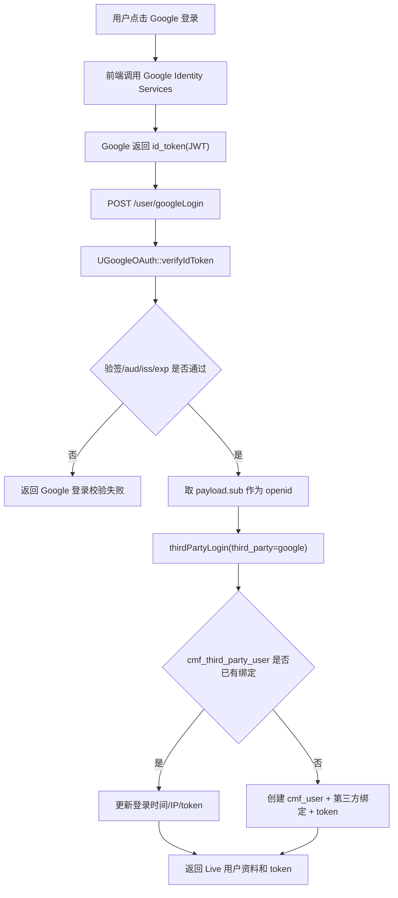
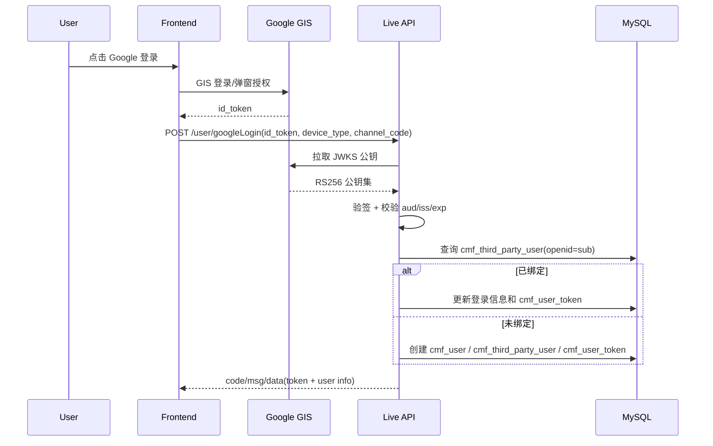

# PM-2990 GIS Google 登录接入文档

> 工单：PM-2990  
> 接口：`/user/googleLogin`  
> 范围：前端 Google Identity Services 登录、Live 后端验签、Live 第三方登录/自动建号。  
> 当前代码：`app/http/live/ctrl/CUser.php::googleLogin()`、`app/util/UGoogleOAuth.php`、`config/google.php`。

## 一、目标

前端接入 Google Identity Services（GIS）后，只把 GIS 返回的 `id_token` 传给 Live 后端。后端校验 JWT 签名、`aud`、`iss`、过期时间后，使用 Google `sub` 作为第三方身份唯一标识，复用现有 `thirdPartyLogin` 链路完成登录或自动注册。

核心原则：

- 后端不信任客户端传入的 Google 用户 ID、邮箱、昵称。
- Google 身份以 `sub` 为准，不以 Gmail 邮箱为唯一键。
- 本登录流程不需要保存 Google `access_token` / `refresh_token`。
- GIS 的 `id_token` 校验不使用 `client_secret`。

## 二、整体流程



## 三、时序图



## 四、接口说明：`/user/googleLogin`

| 项 | 内容 |
|----|------|
| Method | `POST` |
| Content-Type | `application/json` 或表单提交，按项目现有参数解析兼容 |
| Controller | `app\http\live\ctrl\CUser::googleLogin` |
| 鉴权 | 不需要用户 token |
| 成功文案 | `login successful` |

### 4.1 入参

| 参数 | 类型 | 必填 | 默认值 | 说明 |
|------|------|------|--------|------|
| `id_token` | string | 是 | - | Google Identity Services 返回的 JWT。后端只接受这个凭证，不接受客户端自行传 `openid`。 |
| `device_type` | string | 否 | `web` | 设备类型。允许值：`mobile`、`android`、`iphone`、`ipad`、`web`、`pc`、`mac`。 |
| `channel_code` | string | 条件必填 | - | 渠道号。后端优先取公共渠道解析 `getChannelCode()`；取不到时使用本参数。 |

请求示例：

```json
{
  "id_token": "eyJhbGciOiJSUzI1NiIsImtpZCI6Ij...",
  "device_type": "web",
  "channel_code": "b2b_pre"
}
```

### 4.2 成功返回

外层以项目 `respOkJson` 为准，Live 模块正常为：

```json
{
  "code": 0,
  "msg": "login successful",
  "data": {
    "id": 123456,
    "sex": 0,
    "user_type": 2,
    "balance": "0.00",
    "user_nickname": "Google User",
    "avatar": "https://example.com/avatar.png",
    "mobile": "",
    "is_anchor": 0,
    "is_writer": 0,
    "article_num": 0,
    "post_num": 0,
    "attention": 0,
    "heat": 0,
    "votestotal": 1,
    "exp": 1,
    "withdrawal_balance": "0.00",
    "freeze_balance": "0.00",
    "registration_id": 1,
    "token": "live-login-token",
    "userSig": "",
    "votestotal_icon": "https://example.com/level-anchor.png",
    "total_exp": 1,
    "current_exp": 0,
    "exp_icon": "https://example.com/level-user.png",
    "is_guard": 0,
    "guard": {}
  }
}
```

实际返回字段来自 `LBaseUser::thirdPartyLogin()`，前端登录态只需要重点使用：

| 字段 | 说明 |
|------|------|
| `id` | Live 用户 ID |
| `token` | Live 登录 token |
| `user_nickname` | 用户昵称，优先取 Google `name`，为空时取 email，再为空用 `Google User` |
| `avatar` | 用户头像，优先取 Google `picture` |
| `registration_id` | 登录渠道对应平台 ID |

### 4.3 失败返回

HTTP 仍按项目业务响应返回，错误体为 `respErrJson`：

```json
{
  "code": 1,
  "msg": "Google 登录校验失败",
  "data": []
}
```

常见失败：

| 场景 | 返回文案 |
|------|----------|
| `id_token` 为空或格式错误 | `无效的 Google 凭证` |
| `id_token` 过期 | `Google 凭证已过期` |
| 签名、公钥、`aud`、`iss`、`sub` 校验失败 | `Google 登录校验失败` |
| `channel_code` 为空 | `channel 不能为空`（按当前多语言实际文案） |
| `device_type` 不在允许列表 | `Request error` |
| 账号被禁用 | `Account is disabled` |

## 五、后端处理规则

`/user/googleLogin` 只做 Google 凭证换 Live 登录态：

```text
id_token
  -> UGoogleOAuth::verifyIdToken()
  -> payload.sub
  -> openid = sub, third_party = google
  -> LBaseUser::thirdPartyLogin()
  -> Live token
```

写入/更新表：

| 表 | 场景 | 说明 |
|----|------|------|
| `cmf_user` | 首次 Google 登录 | 创建 Live 用户，昵称/头像来自 Google payload。 |
| `cmf_third_party_user` | 首次 Google 登录 | 保存 `third_party=google`、`openid=Google sub`、`user_id`。 |
| `cmf_user_token` | 首次/再次登录 | 写入或刷新 Live token、过期时间、设备类型。 |

## 六、配置

配置文件：`config/google.php`

| 配置项 | 说明 |
|--------|------|
| `web.client_id` | 前端 GIS 使用的 OAuth Client ID。 |
| `allowed_audiences` | 后端允许的 `id_token.aud` 列表，必须包含前端实际使用的 client id。 |
| `issuers` | 允许的签发者：`accounts.google.com`、`https://accounts.google.com`。 |
| `certs_uri` | Google JWKS 公钥地址，当前为 `https://www.googleapis.com/oauth2/v3/certs`。 |
| `leeway` | JWT 时间偏移容忍秒数。 |
| `certs_cache_ttl` | JWKS 本地 APCu 缓存时间。 |
| `http_timeout` | 拉取 JWKS 的超时时间。 |

注意：当前配置中保留了 `client_secret`，但 GIS `id_token` 校验流程不使用它，也不能下发给前端。

## 七、联调清单

| 用例 | 预期 |
|------|------|
| 正常 Google 账号首次登录 | 创建 Live 用户、第三方绑定和 token，返回 `code=0`。 |
| 同一 Google 账号再次登录 | 返回同一个 Live `id`，刷新 token。 |
| `id_token` 为空 | 返回无效凭证。 |
| 过期 `id_token` | 返回凭证已过期。 |
| 错误 `aud` | 返回 Google 登录校验失败。 |
| 错误 `iss` | 返回 Google 登录校验失败。 |
| 错误签名 | 返回无效凭证或校验失败。 |
| 缺少 `channel_code` 且公共渠道解析不到 | 返回渠道不能为空。 |
| 非法 `device_type` | 返回 `Request error`。 |

## 八、当前实现注意点

1. 当前第三方绑定查询主要按 `openid` 查找，并按平台限制 `registration_id in [0, 当前平台]`。后续如支持多个 Google Client ID 或多 App，共享表上建议补强唯一维度：`third_party + app_id/client_id + openid`。
2. `email` 只适合展示或辅助资料同步，不适合作为唯一身份。Google 账号主键必须使用 `sub`。
3. 若前端以前按 `/user/loginGmail` 约定开发，本次应统一改为 `/user/googleLogin`，与当前后端代码保持一致。
